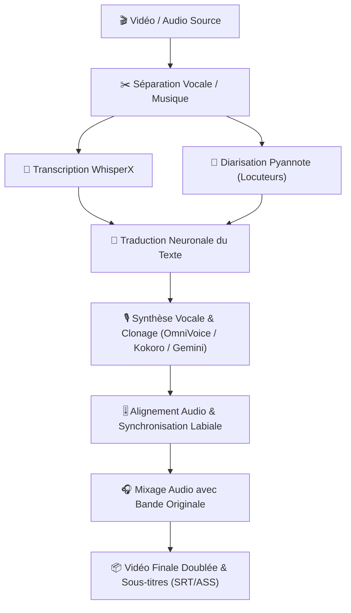

# <h1 align="center">🎬 MKtranslate 🌐🎙️</h1>

<p align="center">
  <strong>Studio Tout-en-Un de Traduction Vidéo Automatisée & Doublage Vocal par Intelligence Artificielle</strong>
</p>

<p align="center">
  <a href="https://colab.research.google.com/github/babiessilky-design/MKtranslate/blob/main/SoniTranslate_Colab.ipynb"></a>
  <a href="https://github.com/babiessilky-design/MKtranslate"></a>
  <a href="https://pytorch.org/"></a>
  <a href="https://huggingface.co/"></a>
  
</p>

---

## 🌟 Présentation de MKtranslate

**MKtranslate** est une suite logicielle avancée de doublage audiovisuel automatique et de traduction synchronisée. Conçue pour les créateurs de contenu, les traducteurs et les studios, elle combine les technologies d'intelligence artificielle les plus performantes pour transcrire, traduire, cloner les voix originales et synchroniser le son avec une précision chirurgicale.

Que ce soit pour traduire une vidéo YouTube, un cours en ligne, un podcast ou une conférence, **MKtranslate** génère une version entièrement doublée dans la langue de votre choix en conservant l'émotion et les timbres vocaux d'origine.

---

## ✨ Fonctionnalités Principales

### 🎙️ 1. Moteurs TTS & Clonage Vocal Zéro-Shot de Nouvelle Génération
MKtranslate intègre nativement un écosystème modulaire de moteurs vocaux :
- **OmniVoice (Par défaut - Ultra-Stable) :** Clonage vocal de référence avec Whisper intégré, température de position nulle (`0.0`) et seed déterministe pour éliminer les dérives de timbre et les bruits parasites sur les voix masculines et féminines.
- **ChatterBox Multilingual :** Moteur haute fidélité pour le clonage multilingue expressif.
- **Kokoro TTS :** Synthèse ultra-rapide et naturelle de qualité studio (voix françaises, anglaises, espagnoles, italiennes, japonaises...).
- **Gemini 2.5 Flash / Pro TTS :** Modèles vocaux neuronaux de pointe de Google.
- **ElevenLabs :** Intégration de l'API ElevenLabs pour des voix de qualité professionnelle.
- **Edge TTS & Coqui XTTS v2 :** Accès à plus de 100 voix gratuites de Microsoft Edge et au clonage multilingue XTTS.

### 🧠 2. Diarisation & Transcription de Précision
- **WhisperX :** Alignement temporel au niveau du mot et horodatage précis.
- **Pyannote Audio :** Séparation et détection automatique des différents intervenants (multi-locuteurs).
- **Détection automatique de genre :** Attribution intelligente des voix adaptées (homme / femme) segment par segment.

### ⚡ 3. Optimisation & Cache Persistant Google Drive
- **Cache intelligent :** Chaque segment déjà synthétisé est conservé dans votre Google Drive pour éviter les recalculs coûteux lors des réessais ou ajustements.
- **Compatibilité GPU T4 / A100 / L4 :** Optimisé pour CUDA 12, cuDNN 8 et PyTorch 2.5.1.

---

## 🚀 Démarrage Rapide

### Option A : Déploiement 1-Clic sur Google Colab (Recommandé)

Le moyen le plus simple et le plus rapide pour utiliser MKtranslate avec un GPU gratuit (T4) :

1. Cliquez sur le badge : [](https://colab.research.google.com/github/babiessilky-design/MKtranslate/blob/main/SoniTranslate_Colab.ipynb)
2. Exécutez la **Cellule 1** : Installation optimisée de l'environnement (UV, PyTorch 2.5.1, CUDA 12).
3. Exécutez la **Cellule 2** : Lancement du serveur Web. Vous obtiendrez un lien public **Gradio** pour accéder à votre interface MKtranslate.

---

### Option B : Installation Locale

#### Prérequis :
- **OS :** Linux (Ubuntu recommandé) ou Windows avec WSL2.
- **GPU :** NVIDIA avec au moins 8 Go de VRAM (CUDA 12 recommandé).
- **Python :** 3.10

```bash
# 1. Cloner le dépôt
git clone https://github.com/babiessilky-design/MKtranslate.git
cd MKtranslate

# 2. Créer un environnement virtuel
python3.10 -m venv venv
source venv/bin/activate  # Sous Windows : venv\Scripts\activate

# 3. Installer PyTorch avec support CUDA
pip install torch==2.5.1 torchvision==0.20.1 torchaudio==2.5.1 --index-url https://download.pytorch.org/whl/cu124

# 4. Installer les dépendances de base
pip install -r requirements_base.txt
pip install -r requirements_extra.txt

# 5. Installer les moteurs de voix
pip install kokoro f5-tts chatterbox-tts omnivoice soundfile

# 6. Lancer l'interface
python app_rvc.py
```

---

## 📂 Bibliothèque de Voix (`voice_library/`)

MKtranslate fournit des voix de référence étalonnées prêtes à l'emploi :
- **`ref_homme_fr.wav`** : Voix masculine française claire et naturelle.
- **`ref_femme_fr.wav`** : Voix féminine française expressive et fluide.
- **`cosy.wav`** (alias `f5-tts_cosy.wav`) : Échantillon studio pour un clonage acoustique riche.

### Ajouter vos propres voix de référence :
Déposez simplement un court fichier audio (`.wav` ou `.mp3` de 5 à 15 secondes) dans le dossier `voice_library/` :
```text
MKtranslate/
└── voice_library/
    ├── ma_voix_perso.wav
    └── ma_voix_perso.txt  (Optionnel : retranscription du texte)
```
La voix apparaîtra automatiquement dans le menu déroulant de l'interface !

---

## 🌐 Langues Prises en Charge

MKtranslate prend en charge la traduction et le doublage dans plus de **60 langues** :

| Code | Langue | Code | Langue | Code | Langue |
| :--- | :--- | :--- | :--- | :--- | :--- |
| **fr** | Français | **en** | Anglais | **es** | Espagnol |
| **de** | Allemand | **it** | Italien | **pt** | Portugais |
| **ru** | Russe | **zh** | Chinois (Simplifié) | **ja** | Japonais |
| **ar** | Arabe | **hi** | Hindi | **ko** | Coréen |
| **tr** | Turc | **nl** | Néerlandais | **pl** | Polonais |
| **uk** | Ukrainien | **vi** | Vietnamien | **id** | Indonésien |
| **sv** | Suédois | **el** | Grec | **cs** | Tchèque |
| **ro** | Roumain | **da** | Danois | **fi** | Finnois |
| **hu** | Hongrois | **no** | Norvégien | **th** | Thaïlandais |

---

## 🛠️ Schéma de Fonctionnement



---

## 🔑 Clés API & Tokens (Optionnel)

Pour débloquer toutes les fonctionnalités avancées :
- **Hugging Face Token :** Requis pour Pyannote Diarization ([hf.co/settings/tokens](https://hf.co/settings/tokens)). Assurez-vous d'avoir accepté les conditions de [pyannote/speaker-diarization-3.1](https://huggingface.co/pyannote/speaker-diarization-3.1).
- **Google GenAI Key :** Pour la traduction rapide et Gemini TTS ([aistudio.google.com](https://aistudio.google.com/)).
- **ElevenLabs API Key :** Pour les voix ElevenLabs ([elevenlabs.io](https://elevenlabs.io/)).

---

## 🤝 Contribution & Remerciements

MKtranslate est basé sur l'écosystème open-source et enrichi avec des moteurs de pointe :
- [WhisperX](https://github.com/m-bain/whisperX) par Max Bain.
- [Pyannote Audio](https://github.com/pyannote/pyannote-audio) par Hervé Bredin.
- [OmniVoice](https://github.com/k2-fsa/OmniVoice) par K2-FSA.
- [Kokoro](https://github.com/hexgrad/kokoro) par Hexgrad.
- [SoniTranslate](https://github.com/R3gm/SoniTranslate) par R3gm.

---

<p align="center">
  Développé et maintenu par <a href="https://github.com/babiessilky-design"><strong>babiessilky-design</strong></a>
</p>
